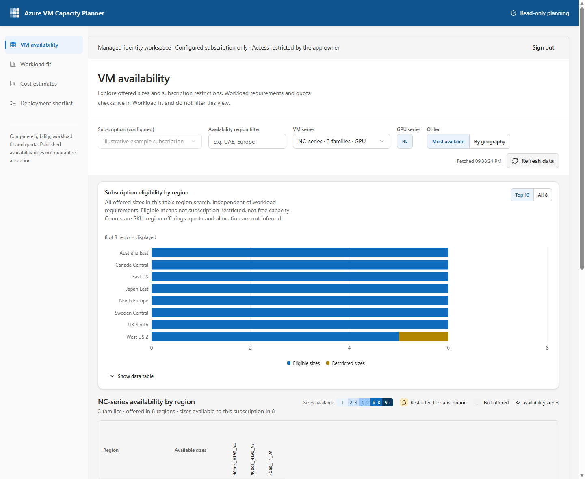
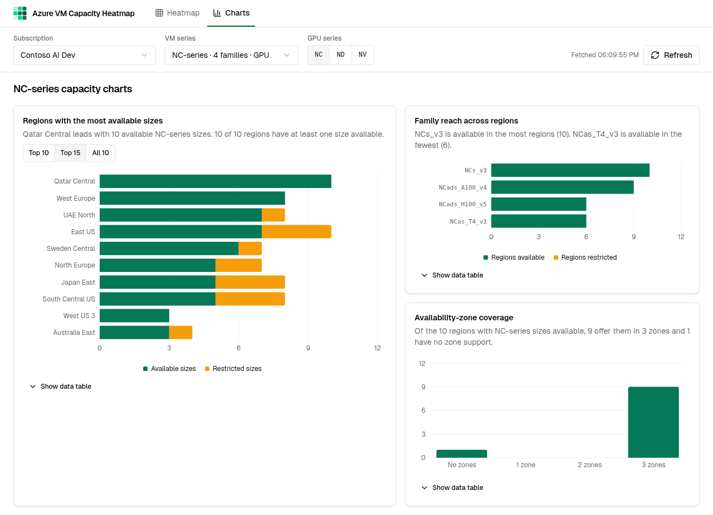

# Azure VM Capacity Planner

> [!WARNING]
> **This is not a production app.** It is a prototype / proof of concept built for exploration and
> internal discussion. It has not been security-reviewed, load-tested, or validated for accuracy, and it
> comes with no support or SLA. Do **not** use it as the sole basis for capacity planning, customer
> commitments, or deployment decisions — always confirm in the Azure portal, with a real deployment, or
> through official Microsoft capacity channels.

A small web app that shows **where Azure VM sizes are available to a given subscription**, so you can
quickly spot which regions offer a VM series (for example the **NC** GPU series) and which families are
restricted.

- **VM availability (`/`)** — raw subscription eligibility, independent of workload requirements.
  A chart contrasts eligible and restricted sizes by region, with an accessible data table.
  The regions × VM families matrix shows how many sizes of
  that family are available to the subscription in that region; locked cells are offered but restricted
  for the subscription; dots mean not offered. Click a region or cell for per-size details
  (vCPU, GPU, memory, zones, restriction reason).
- **Workload fit (`/charts`)** — apply minimum active vCPUs, RAM (GiB), GPU count and
  available zones per VM, plus the number of additional VMs to assess. Zero disables a minimum;
  unknown capabilities do not pass an active minimum. Its chart separates matching eligible sizes,
  matching subscription-restricted sizes and offerings excluded by requirements, with an accessible
  table. Defaults preserve all offerings, but this tab never changes the VM availability view.
- **Quota coverage & deployment readiness (Workload fit only)** — explicitly scan up to 50 regions in the
  current series, region-search and applied-workload scope, with at most three concurrent read-only quota requests. A
  region is ready when at least one matching, subscription-eligible SKU has sufficient regional and
  family vCPU headroom for the requested VM count; blocked, unknown and unchecked states remain distinct.
- **Region comparison (Workload fit only)** — explicitly select up to three regions for side-by-side matching
  SKUs, subscription restrictions, zone coverage, and regional/family vCPU usage, limits and headroom.
- **CSV download (Workload fit only)** — exports all results matching the applied subscription, series, region search
  and workload filters (not only the chart's top-N rows or a selected heatmap cell). Includes restrictions,
  zones, additional VM count, quota status and available fetch timestamps.
- **Cost estimates (`/cost`)** — compares matching, subscription-eligible sizes in a selected region using public
  Azure pay-as-you-go hourly retail rates. Choose Linux or Windows and runtime hours; the view calculates
  monthly per-VM and requested-count estimates in USD. Spot, reservations, negotiated discounts, storage,
  networking, tax and additional software licensing are excluded.
- **Deployment shortlist (`/shortlist`)** — compare up to three exact SKU/region alternatives across series,
  inspect capabilities and restrictions, explicitly check regional/family vCPU quota, and export a shortlist CSV.
  Shortfall guidance distinguishes additional vCPUs from the required total quota limit and links to Azure's
  quota workflow; it submits no requests. Each candidate uses the current workload count independently.
  Selection is memory-only and clears on subscription/account changes or reload. The old `/scenarios`
  URL redirects here; existing saved presets are left untouched in browser storage, not migrated or deleted.

## Interface and loading

The interface follows Microsoft Fluent 2 design principles: Segoe UI/system typography,
Microsoft blue, neutral layered surfaces, consistent controls, visible keyboard focus,
and desktop side navigation that becomes a horizontal navigation bar on smaller screens.
The existing Radix/shadcn controls remain the accessible interaction primitives; no new
UI runtime dependency is required.

Availability and workload charts display labelled, chart-shaped loading placeholders on
initial reads. During refresh, existing charts stay visible with a spinner, a live status
announcement and a busy state. Filter-driven chart calculations use React deferred rendering
so controls can respond before the next chart is ready. Refresh stays disabled until all
scope reads finish; failures remain explicit errors rather than stale-success results.
Retail-price refresh also retains prior estimates while the request is in flight.
Reduced-motion preferences disable decorative animation.

## Screenshots

These current Fluent 2 captures use isolated, fictional illustrative data, not a live Azure
subscription. Availability and workload results in the images are examples only.

### VM availability



### Workload fit



## Where the availability values come from

Dashboard values come from the **Azure Resource Manager (ARM) REST API**, using the signed-in
user's own Azure permissions in managed, standalone and CLI modes, or the backend's managed identity
in App Service hosted mode. There is no sample-data fallback. These read-only endpoints are used:

| Data | ARM API | API version |
|------|---------|-------------|
| Subscriptions the user can see | `GET /subscriptions` | `2022-12-01` |
| Configured local CLI or hosted subscription (instead of listing all) | `GET /subscriptions/{id}` | `2022-12-01` |
| Region names and geography | `GET /subscriptions/{id}/locations` | `2022-12-01` |
| VM sizes per region, zones and restrictions | `GET /subscriptions/{id}/providers/Microsoft.Compute/skus` ([Resource SKUs – List](https://learn.microsoft.com/rest/api/compute/resource-skus/list)) | `2021-07-01` |
| Regional compute usage and quota, on explicit region selection or coverage scan | `GET /subscriptions/{id}/providers/Microsoft.Compute/locations/{region}/usages` ([Usage – List](https://learn.microsoft.com/rest/api/compute/usage/list?view=rest-compute-2025-04-01)) | `2025-04-01` |

How the app derives "availability" from the Resource SKUs response (only `resourceType = virtualMachines`):

- **Offered in a region** — the SKU lists the region in `locationInfo` / `locations`.
- **Restricted** — the SKU has a `restrictions` entry of type `Location` for that region
  (typically `reasonCode: NotAvailableForSubscription`). Shown as locked / amber.
- **Some zones restricted** — a `restrictions` entry of type `Zone` removes specific zones in that region.
- **Available** — offered and not restricted for the subscription. The zone count is the zones in
  `locationInfo[].zones` minus any restricted zones.
- **Series** is the leading letters of the size name (`NC24ads_A100_v4` → `NC`); **family** is the SKU's
  `family` field (e.g. `standardNCADSA100v4Family`); vCPU, GPU and memory come from the SKU `capabilities`.

### Workload and quota interpretation

VM availability uses the selected subscription and series, plus its own availability-only region
search and ordering. Its matrix, eligibility chart and offer/restriction drilldowns ignore workload
count, capability minima, zone minima, comparison selections and the Workload fit region search.
It has no requirements form, quota comparison or CSV action.

Workload fit alone owns requirements, matching/exclusion analysis, selected-region quota comparison,
quota coverage and the deployment-readiness report, and filtered CSV. Its matching results, chart's
match counts, coverage scope and CSV share the same applied filters.
The chart also counts offerings excluded by requirements within this tab's region search, rather
than hiding those exclusions. Count changes quota demand, not per-VM capability matching.
Each tab's region search matches the region identifier, display name or geography. Searches and
applied requirements persist independently when navigating; subscription/series and authentication
are shared. Restrictions are not
silently filtered out: capability/zone fit, subscription eligibility and quota sufficiency are
independent. Comparison includes exclusion reasons for sizes rejected by the current filters.
GPU count is a count only, not a match for GPU model, architecture or performance.

Cost estimates use the public, unauthenticated Azure Retail Prices API. They match exact VM SKU and region
to current hourly consumption meters, excluding Spot and Low Priority meters, and show Microsoft retail
prices in USD. Windows selects a published Windows meter when available. Monthly values are
`hourly retail rate × runtime hours × requested VM count`; runtime defaults to 730 hours and is limited
to 1–744 hours. The estimate is compute-only and does not include negotiated terms, reservations,
storage, networking, taxes, or additional software licensing. Validate prices against the applicable
agreement and Azure pricing tools before using them for a commitment.
The API does not enable browser CORS, so local development routes requests through Vite's same-origin
`/api/retail-prices` proxy. The included Azure Static Web Apps function in `api/retail-prices`
provides the production route, with exact SKU/region query validation, a fixed upstream,
a 20-second timeout, bounded responses, and short-lived caching of public prices only.
The browser must not call the Retail Prices endpoint directly.

Legacy saved scenarios remain in browser `localStorage` but are no longer exposed in navigation.
The deployment shortlist stores only candidate keys in memory and resolves them against the current
subscription's catalog. Quota reads are explicit, bounded to three candidate regions, and cached for
five minutes. Changing the selected region set requires a new check. Failed reads stay unknown and
can be retried. Export includes current catalog/quota timestamps; neither export nor sufficient quota
guarantees allocation. Workload fit places matching results before collapsible region/quota tools.

The VM count defaults to 1 and accepts integers from 1 to 10,000. Capability minima default to 0;
vCPU/GPU minima are whole numbers, RAM accepts fractional GiB, and available-zone minimum is 0–3.
Edits take effect on **Apply workload**; invalid inputs leave the previous applied values unchanged.
**Reset workload** restores these defaults, without resetting the subscription/series/region search.

Quota assessment is for **additional regular (non-Spot) instances of each candidate SKU**:
`requested VM count × SKU vCPUs`. Both total regional (`cores`) and the exact SKU family's usage
name must have sufficient remaining headroom (`limit − currentValue`). A known shortfall in either
is insufficient; otherwise a missing/unsupported family, invalid/missing metric or unknown vCPU
count is unknown, never unlimited or zero. Loading, fetch errors and not-requested regions have
their own statuses. No quota is inferred from SKU restrictions. "Sufficient" refers only to these
two vCPU quotas, not other limits (such as VM count), actual free capacity, or allocation guarantees.

For [constrained-core sizes](https://learn.microsoft.com/azure/virtual-machines/constrained-vcpu),
workload fit and displayed active cores use `vCPUsAvailable`, while quota uses the full base
`vCPUs` capability, not the reduced active count. A constrained size without the active-core
capability stays unknown for an active vCPU minimum. Missing base cores make quota unknown.
Zone coverage uses subscription-usable zones after restrictions; logical zone numbers do not
establish physical equivalence across subscriptions or regions. No deployment is executed.

### Permissions and caching

The existing managed ARM connector's `Provider_Resources_GetById` reads
`Microsoft.Compute` / `locations/{region}/usages`; generated connector output is unchanged.
The ARM identity needs `Microsoft.Compute/locations/usages/read` at the subscription (for example
through Reader), as well as read access for the existing subscription, location and SKU discovery.
The app does not grant permissions or request quota increases.
Policy, permission, API and connector failures are shown explicitly; raw connector errors are not
echoed because they can contain tenant/environment details. Direct ARM reads follow validated
same-endpoint pagination, bounded to 100 pages and 100,000 items per read. An invalid, repeated or
over-limit page fails the entire read, never returning partial results. The generated managed
connector does not expose a generic next-link operation; paginated managed responses are therefore
explicitly rejected rather than displayed as complete subscription, SKU or quota results.

Quota cache identity includes **mode + account/session + subscription + region** in standalone/CLI/hosted modes
(subscription + region in managed mode). Quota data stays fresh for five minutes and remains cached for
up to one hour while unused. The explicit coverage scan is limited to 50 eligible regions
in the current series and region-search scope, with at most three quota reads in flight. It reads only
regions with at least one matching, subscription-eligible SKU; non-matching or fully restricted regions
are assessed without quota requests. VM availability does not fetch or refresh quota, even if comparison
selections are retained. Selected-region views and coverage scans reuse fresh cache entries, and window
focus/reconnect do not trigger quota requests. **Refresh quota** retries one
comparison region; **Refresh quota coverage** explicitly re-reads the coverage scope. Workload fit's main
**Refresh** re-reads currently selected comparison regions, not the coverage scan. Errors are not automatically
retried. Switching subscription clears comparison selections. SKU and subscription data stay fresh for
15 minutes; region metadata stays fresh for one hour. Inactive dashboard query results are retained in
memory for up to one hour, and public price results for 24 hours. Refresh controls explicitly fetch
current data. All dashboard result caches and filters stay in browser memory only and disappear on reload;
results are not an atomic snapshot and can change after fetch.
An optional local CLI disk cache and the hosted backend's shared in-memory read cache are exceptions
to browser-only result caching; see below. Hosted viewers share the explicitly configured backend
identity's access, not their individual Azure RBAC permissions.
Standalone sign-in, account changes and sign-out cancel/remove ARM queries and reset the selected
subscription and comparison regions. Each successful sign-in gets a new cache generation, including
signing into the same account again, so a previous session's results are not reused.

CSV generation is entirely local, with no external upload or persistence. It includes the selected
subscription's ID/name and relevant planning context only, quotes and escapes every cell, neutralizes
formula-like untrusted strings, writes unknown values explicitly, and revokes temporary download URLs.
Quota for regions not selected for comparison is **not-requested**, not a claim of sufficiency.
Treat exported subscription metadata as internal information and share appropriately.

### What these values do **not** tell you

- They are **not real-time free capacity**. Azure does not publish how many machines are free in a
  region. "Available" means the size is *offered and not blocked for this subscription* — a deployment
  can still fail with an allocation / capacity error.
- VM availability's eligibility count does **not** establish quota sufficiency. Use Workload fit's on-demand
  comparison quota checks; an eligible size can still exceed regional or family quota.
- Results are **per subscription**; another subscription (or offer type) can see different restrictions.
- SKU data is fresh for 15 minutes and quota data for 5 minutes; use **Refresh** to re-read.

## How it runs

The app supports four explicit read paths, sharing the same parsers, filters, quota assessment,
query caching and CSV logic:

- **Managed** — the Power Platform **Azure Resource Manager connector** (`shared_arm`) via the
  `@microsoft/managed-apps` runtime; the typed client lives in unchanged `generated/` output.
  This is the default outside loopback and requires Power Apps.
- **Standalone** — Microsoft **MSAL Browser** authorization-code flow with PKCE and direct ARM
  GET requests. This is the default on `localhost`, `127.0.0.1` and `[::1]`. It never silently
  falls back to the managed connector or sample data. Missing configuration shows setup instructions;
  no ARM reads run before sign-in.
- **Hosted App Service** — explicit `VITE_ARM_MODE=hosted`. App Service authenticates users using
  tenant-pinned Entra OIDC, with an explicit user object-ID allowlist enforced by both Easy Auth and
  the backend. A same-origin Node backend uses its system-assigned managed identity for read-only ARM
  calls against one configured subscription. No ARM tokens or client secrets reach the browser.
- **Local CLI** — opt-in `VITE_ARM_MODE=cli` in the development preview only. A separate Node
  loopback bridge uses the official Azure CLI's existing authorized context to issue ARM GET reads.
  Tokens never reach the browser. No MSAL registration is needed for this path.

`VITE_ARM_MODE=managed`, `standalone`, `cli` or `hosted` explicitly overrides the origin default. An invalid mode
fails closed. Client-facing `VITE_` variables are embedded at Vite startup/build time; restart after changing
them. The server-only CLI scope variable is read independently at bridge startup. When packaging for Power Apps from a checkout with standalone `.env.local`, explicitly build
with `VITE_ARM_MODE=managed` or remove the standalone override.

### App Service hosting and continuous deployment

This deployment uses a **paid Linux B1 plan with Always On**, hosting both the frontend and a
dependency-free Node 22 backend. It does not replace or delete an existing Static Web App.
Check the selected region's App Service quota before provisioning; a B1 limit of zero requires
an approved increase to at least one instance through [Azure Quotas](https://aka.ms/azure-quota).
The selected subscription must be in the same tenant as the authentication app registration.

The three identities have separate purposes:

| Identity | Access |
|----------|--------|
| App Service system-assigned identity | Reader on the one configured Azure subscription |
| Dedicated authentication user-assigned identity | Federated credential on the existing Entra application; no Azure RBAC assignment |
| GitHub deployment user-assigned identity | Website Contributor on this App Service only; federated to this repository's `main` branch |

GitHub's OIDC subject includes the repository owner and repository's stable numeric IDs. The
infrastructure template defaults to this repository; deployments from another repository must
provide its matching owner ID and repository ID as well as its `owner/name`.

Viewers receive the **backend identity's shared read access**, not their own subscription permissions.
Only explicitly allowed Entra user object IDs in the configured tenant can use the app. Easy Auth
must remain enabled: the Node server trusts its platform-injected principal header, not a header
supplied by an untrusted reverse proxy. The health endpoint exposes only `{"status":"ok"}` anonymously;
the frontend and all data endpoints require authentication. Do not expose the Node port directly.

Easy Auth requests only OIDC sign-in scopes, not delegated ARM consent. Its application credential
is a managed-identity federated assertion, not a secret. The script adds a Web callback while
preserving existing SPA redirect URIs, enables ID-token issuance for Easy Auth's `code id_token`
hybrid flow, and adds one federation. It preserves the existing implicit access-token issuance
setting (new deployments do not need it enabled) and does not change configured API
permissions, existing credentials, tenant consent policies or grant consent. **Tenant policy can
still require administrator approval for user sign-in**; managed identity does not bypass it.
If sign-in fails at the callback with Entra error `700054`, verify that **ID tokens** is enabled
under the app registration's **Authentication > Implicit grant and hybrid flows**; Easy Auth's
hybrid request needs this even though its authorization code is redeemed server-side.
Provisioning requires resource/RBAC administration and ownership of the existing app registration.

From PowerShell 7, substitute your reviewed target and the allowed user's **object ID in that tenant**:

```powershell
.\scripts\provision-app-service.ps1 `
  -SubscriptionId "<subscription-guid>" -ResourceGroup "<existing-resource-group>" `
  -AppName "<unique-app-name>" -Location "eastus2" `
  -TenantId "<tenant-guid>" -ClientId "<existing-application-client-guid>" `
  -AllowedUserIds "<tenant-user-object-guid>" -ValidateOnly

# After successful validation, repeat without -ValidateOnly to create paid resources.
.\scripts\deploy-app-service.ps1 `
  -SubscriptionId "<subscription-guid>" -ResourceGroup "<existing-resource-group>" `
  -AppName "<unique-app-name>"
```

The provisioning output includes the actual URL and deployment identity's public client ID.
Provisioning is incremental and can be re-run with the same reviewed inputs; it deliberately does not
silently replace a conflicting authentication federation. A partially failed deployment requires
inspection before retrying or cleanup. Manual deployment uses the caller's Azure CLI authentication,
builds with `VITE_ARM_MODE=hosted` and `VITE_BASE=/`, and packages only the production frontend,
backend and required shared modules. No `.env` files, CLI credentials, development dependencies or
`node_modules` are deployed. Packaging always rebuilds in hosted mode and requires an empty output
directory outside the repository, so it cannot reuse a stale CLI or standalone build.
Health and anonymous-access checks are not proof of interactive sign-in
or successful managed-identity ARM access; verify those separately after RBAC propagation.

For automated updates, a repository administrator must publish `.github/workflows/deploy-app-service.yml`
and set these **repository variables** (none are secrets):

```powershell
gh variable set AZURE_DEPLOY_CLIENT_ID --repo "<owner/repository>" --body "<DeployClientId from provisioning>"
gh variable set AZURE_TENANT_ID --repo "<owner/repository>" --body "<tenant-guid>"
gh variable set AZURE_SUBSCRIPTION_ID --repo "<owner/repository>" --body "<subscription-guid>"
gh variable set AZURE_WEBAPP_NAME --repo "<owner/repository>" --body "<app-name>"
gh variable set AZURE_RESOURCE_GROUP --repo "<owner/repository>" --body "<resource-group>"
```

Pushes to `main` and manual workflow dispatches run regression tests, build and package the app,
then use GitHub OIDC for deployment. Only the deployment job receives `id-token: write`.
No publish profile, deployment password or client secret is needed; FTP and SCM basic authentication
are disabled. A successful pipeline checks backend health and anonymous API denial. It does not
automate user consent. Changing the repository or deployment branch requires updating both the
Azure federation and workflow. Treat writers to the deployment branch as trusted deployers.

Hosted reads are pinned to four fixed ARM endpoint shapes, with same-endpoint pagination,
100-page/100,000-item/200-MiB cumulative response bounds and a 180-second read deadline.
At most three distinct ARM reads and three retail-price reads run concurrently; excess requests
receive an explicit retryable error. Concurrent identical ARM reads coalesce. The process caches up
to 64 projected results: catalogs for 15 minutes, quota for five minutes and subscription/region
metadata for an hour. First reads may reuse that cache across authorized sessions; successful
browser-session rereads explicitly bypass it. Caches are memory-only and expire on app restart.
Subscription responses use `private, no-store`; tokens and raw ARM envelopes never reach clients.
Failed or oversized reads return errors, not partial results or stale-success fallbacks.

### Local Azure CLI development

This is **not a tenant-consent bypass**. Azure CLI must already be legitimately authorized for
ARM, and organizational policy must allow its use. The CLI account needs the same Azure RBAC
read permissions listed above. The dashboard never runs `az login`, changes the default
subscription/cloud, grants consent or roles, or creates an app registration. If CLI authorization
is denied or requires interaction, use your organization's approved process separately.

1. Install the official Azure CLI and Node **22.18+ or 24+**, then check `az account show`
   yourself. Only the Azure public-cloud **user** context is supported. On Windows the bridge
   invokes the official MSI's `Microsoft SDKs\Azure\CLI2\python.exe` below `Program Files` with
   `-IBm azure.cli`; on other systems it invokes installed `az`. No shell command interpolation.
2. Set `VITE_ARM_MODE=cli` in gitignored `.env.local`; the MSAL settings are ignored in this mode.
   Start/restart the preview with **`npm run dev -- --host 127.0.0.1 --port 5173 --strictPort`**
   at exactly **`http://127.0.0.1:5173/`**.
3. In a separate terminal in this repository, run **`node scripts\cli-arm-server.mjs`**.
   It binds only **`127.0.0.1:5174`**. Keep both terminals running. No dependency or Vite
   configuration changes are required.
4. Choose **Connect Azure CLI**. This checks CLI context, not ARM read success. Actual subscription,
   SKU and quota permission/API errors remain visible. **Reconnect CLI** creates a fresh dashboard
   session/cache generation. **Disconnect** clears dashboard data without signing the CLI out.

For a single-subscription local deployment, optionally set **`ARM_SUBSCRIPTION_ID=<subscription-guid>`**
in gitignored `.env.local` (or the bridge process environment), then restart the **bridge** and reconnect.
This server-only setting is not a `VITE_` variable; no Vite restart is needed solely for a scope change.
Use the exact GUID, not a subscription name. Malformed configuration prevents bridge startup.
An empty setting retains multi-subscription discovery; managed and MSAL modes are unaffected.
Before connecting, **`az account show --subscription <subscription-guid>`** must resolve the target
in the CLI's already authorized profiles. Access to another subscription does not establish access
to this one. If it is absent, use your organization's approved account/tenant sign-in process
separately; the dashboard neither logs in nor falls back to another profile.

With this setting, the bridge never lists all subscriptions: it reads only
**`GET /subscriptions/{configured-id}?api-version=2022-12-01`** and displays the actual ARM name.
Every location, SKU and quota request is restricted to that GUID server-side, including requests
crafted outside the UI. CLI profile/token resolution uses an explicit `--subscription` argument,
without changing CLI defaults; the target tenant/account and current CLI context are pinned to
the session. Missing CLI profiles, inaccessible subscriptions, mismatched ARM results and permission
errors fail explicitly, with no fallback to another subscription. A subscription switch is disabled
in the dashboard; scope changes/reconnection clear old data, selection, comparison and query caches,
and reads for the configured target start only after ARM has returned that exact subscription.
This is a local application restriction, **not an Azure RBAC or tenant-permission change**.

The bridge accepts only the exact dashboard origin, Host and loopback peer, with custom request
headers, exact CORS (no credentials/wildcards), and anti-CSRF checks on local connect/disconnect
actions. The browser sends typed endpoint descriptors, **not URLs or CLI commands**. The server
constructs only the documented dashboard GET endpoints above, validates GUID/region inputs,
pins API versions, rejects redirects and foreign/changed pagination endpoints, and bounds reads
to 100 pages/100,000 items. Pagination accepts only the API version and recognized continuation
token parameters. Only fields used by this dashboard are returned; raw CLI output, CLI identities,
tokens and provider error bodies are never returned or logged.

Each local session pins the CLI user, tenant and default subscription. Tokens are obtained in
that explicit context server-side; dashboard subscription selection changes only the read path,
never CLI defaults. Sessions expire after 30 minutes of inactivity and are invalidated on restart;
successful status checks and reads renew that idle window. Context is checked before and after each
complete read, plus browser status checks about once a minute and when a stale page regains focus.
Each page of a paginated ARM response is still validated, without launching another CLI context
process per page. A detected account/tenant/default-subscription change, logout or rejected ARM
authorization clears browser data and requires reconnecting. Temporary CLI or bridge failures remain
visible and retryable without discarding the local session. Changes made in another terminal are not
instantaneously observable between checks. Successful metadata checks do
not prove current ARM access or that a cached quota/SKU snapshot is still current; use Refresh for
new ARM reads. CLI token refresh happens only through its official existing credential cache.

Local session handles and browser dashboard data remain in memory. The bridge keeps only bounded
in-memory session metadata and request-lifetime tokens; it never persists credentials.
Set the server-only `ARM_SKU_CACHE=true` in `.env.local` and restart the bridge to opt into
a compressed local VM catalog cache. It stores only the projected VM metadata needed by the planner,
not tokens, session handles, account names, subscription lists, quota or prices. Each snapshot is
isolated by the CLI user, tenant, default context and requested subscription, remains usable for
15 minutes from its original fetch, and preserves that timestamp in the UI with a **Local cache** label.
At most four snapshots are retained in `%LOCALAPPDATA%\AzureVmCapacityPlanner\Cache` on Windows
(`~/.cache/AzureVmCapacityPlanner/Cache` elsewhere).
The CLI context is revalidated before using any snapshot; cached data does not prove current
ARM permissions or live availability. A first catalog read after reconnect/reload or bridge restart
can reuse the snapshot. Later catalog reads in that session, including **Refresh**, fetch Azure again.
Browser freshness uses the snapshot's original age, not its time of retrieval.
A cold or expired catalog still needs a complete Azure download, which can be large and slow.
Expired snapshots are discarded on read and old snapshots are pruned on write; there is no background
cleanup while the bridge is stopped. Disconnect clears browser results, not this opt-in cache.
Set `ARM_SKU_CACHE=false` to stop using it; delete the named cache files to remove stored metadata.
Cache failures are explicit, not disguised as a live result.
The installed CLI itself owns its pre-existing credential storage. CLI subprocesses have a 30-second
timeout and 1 MiB output bound; complete reads have a two-minute deadline, including queue time.
At most four operations run concurrently, with up to eight additional requests queued to accommodate
dashboard refresh/navigation bursts. A full queue returns an explicit busy error without disconnecting
an otherwise valid session. Cancellation removes queued requests and stops subprocess/network work where supported; partial results
are discarded. Missing CLI, expired login/policy interaction, permission denial and timeout have
explicit errors and no managed/sample fallback.

This path is local development only and fails closed in production builds or on another preview
origin/port. Do not expose either server on a network interface, public tunnel or reverse proxy.
The origin boundary trusts code served by this local preview, not hostile local processes or
compromised same-origin code. Stop the bridge when finished. Power Apps packaging must use
`VITE_ARM_MODE=managed`; the CLI server is not a deployment backend.

### Standalone Azure sign-in prerequisites

Hosted prototype: **https://calm-cliff-0eb082d0f.5.azurestaticapps.net/**.
It uses the configured single-tenant Microsoft Entra registration; visitors need an account permitted
by that registration and their own Azure read permissions. The hosted app does not use the developer's CLI session.

For hosted deployment, provision an Azure Static Web App (the Free plan supports this prototype)
and add its exact HTTPS root URL to the existing registration's **SPA** redirect URIs.
Preserve any existing redirect URIs. Review the prerequisites below before granting consent.
Then run from PowerShell with the chosen resource and public application identifiers:

```powershell
.\scripts\deploy-static-web-app.ps1 -SubscriptionId <subscription-id> -ResourceGroup <resource-group> -Name <static-app-name> -ClientId <client-id> -TenantId <tenant-id>
```

The script deploys the current working tree, including uncommitted changes. It creates no Azure
resources, changes no registration/permissions, and never uploads `.env.local` or the CLI bridge.
It builds with standalone sign-in and a root asset base, deploys `dist` plus the managed pricing
function using the pinned official SWA CLI, and restores process environment variables afterward.
Deployment credentials stay in process environment only; do not print or save them.
The local preview remains in CLI mode. The site assets are public; Azure data remains behind
each user's sign-in and Azure RBAC. Scenarios stay local to each browser and origin.
Static Web Apps routing supports direct links to `/charts`, `/cost`, and `/shortlist`.
The former `/scenarios` URL redirects to `/shortlist`.
Verify the hosted pages, pricing endpoint, and an interactive Azure sign-in after deployment.
The Free plan has platform quotas and no production SLA; do not upgrade or enable billable extras implicitly.

Copy [`.env.example`](.env.example) to gitignored `.env.local`, then fill in the existing registration's
public client and tenant IDs. The preview here uses **`http://127.0.0.1:5173/`**; keep that exact origin
for both Vite and the redirect. These are configuration steps, not creation of an app registration.

An existing app registration suitable for the local preview needs:

- The **Application (client) ID** (a GUID), not its **Application ID URI** (`api://...`), and the
  **Directory (tenant) ID**. An organizational multi-tenant authority is appropriate only if the
  registration supports that account type.
- A **Single-page application** platform entry with the redirect URI **`http://127.0.0.1:5173/`**.
  `localhost` and `127.0.0.1` are different origins; the URI must match the running preview exactly.
- Delegated **Azure Service Management → user_impersonation** permission and any consent required
  by the tenant. The signed-in user also needs the Azure RBAC read permissions described above;
  app consent does not grant subscription access.

Use a directory GUID for a single-tenant registration. The explicit `organizations` tenant value is
also supported for an organizational multi-tenant registration; it is not assumed automatically.
Redirects must be the current origin's root path, without query, fragment or credentials, and HTTPS
is required outside loopback. This implementation targets the Azure public cloud only.

Both authentication surfaces use a compact, Fluent-inspired hierarchy: restrained status accents,
one primary connect/sign-in action, secondary account/session actions and disclosed setup details.
Connection status describes authentication/context only; it is never a substitute for an ARM read.
Unprefixed standalone and CLI routes use the origin root, so directly opening or reloading
`/charts` renders correctly. Matching preview mount prefixes and managed deployment routing are preserved.

**Sign in to Azure** opens Microsoft's popup; **Switch account** (or **Sign in again** after a session
error) explicitly reopens account selection. The connection area says **Signed in**, not "capacity
available" or "ARM access verified"; read failures remain visible in the dashboard. **Connection
details** discloses the directory, required redirect and session/permission guidance without putting
raw identifiers in the main workflow. The SDK's redirect bridge completes the popup at the existing root URL without
starting another sign-in or ARM read. Popup restrictions, tenant policy, a missing SPA redirect or
consent can prevent completion. Silent token renewal uses only MSAL's access/refresh-token cache;
an interaction-required result shows an explicit sign-in error, never an unsolicited popup.
**Sign out** immediately clears dashboard data and asks Microsoft to end the session; cancellation
or popup failure is reported, and the local token/account cache is still cleared.

MSAL's account/token cache is **memory-only**; reload requires sign-in again. MSAL may use session
storage for temporary protocol/interaction metadata, separately from that token cache. Microsoft's
identity provider session may persist independently. Tokens are not put in Zustand, TanStack Query, browser
storage, CSV exports, application logs or app-authored parent messages. Only metadata and ARM
results are held in the dashboard's in-memory caches. Direct requests send credentials only as
an Authorization header to `https://management.azure.com`, omit cookies and reject HTTP redirects.
The OAuth delegated permission is broad `user_impersonation`, not a granular read-only OAuth scope;
the application adapter itself is GET-only and Azure RBAC still controls accessible resources.

The client ID, tenant and redirect URI are public browser configuration, **not secrets**. A SPA must
not use a client secret. Do not paste passwords, secrets or access/refresh tokens into source,
configuration forms, logs, URLs, or issue reports. Registration changes or permission grants must
be performed separately by an authorized owner; documenting these prerequisites does not perform
or authorize those changes. See [Microsoft's SPA configuration guidance](https://learn.microsoft.com/entra/identity-platform/scenario-spa-app-configuration).

### Code map

| Path | Purpose |
|------|---------|
| `src/lib/azure-capacity.ts` | ARM reads, parsing of Resource SKUs into per-region offers, shared filter hook |
| `src/lib/arm-config.ts`, `src/lib/azure-session.ts` | Validated public configuration, MSAL session and account-isolated read context |
| `src/lib/arm-client.ts`, `src/lib/arm-http.ts` | Managed/direct adapter and bounded, GET-only ARM transport |
| `src/components/azure-access.tsx` | Configuration, sign-in/error/logout UX and SDK popup callback |
| `scripts/cli-arm-server.mjs` | Loopback-only, context-pinned official CLI bridge with fixed read endpoints |
| `src/lib/cli-session.ts`, `src/components/cli-access.tsx` | Local session/cache cleanup and Fluent-inspired CLI connection UX |
| `src/lib/subscription-scope.ts` | Exact optional scope validation and verified subscription selection |
| `src/pages/home.tsx` | VM availability page (`/`), matrix and raw offer/restriction details |
| `src/pages/charts.tsx` | Workload fit page (`/charts`) |
| `src/lib/capacity-view.ts`, `src/components/offer-summary-chart.tsx` | Isolated view selection and purpose-specific eligibility vs matching/exclusion chart presentation |
| `src/components/scope-controls.tsx` | Subscription / series pickers and refresh |
| `src/components/planning-controls.tsx` | Workload form, on-demand comparison/quota and CSV download |
| `src/lib/workload-planning.ts` | Shared fit, constrained-core, quota and CSV logic |
| `tests/workload-planning.test.mjs` | Focused Node test-runner coverage (Node 22.18+ with TypeScript stripping, or Node 24+) |
| `tests/arm-standalone.test.mjs` | Configuration, account cache identity, transport/pagination, cancellation and safe-error fixtures |
| `tests/cli-bridge.test.mjs` | CLI boundary/CSRF/context/redaction, exact subscription restriction, stale selection cleanup and fixed-endpoint fixtures |
| `generated/` | Auto-generated ARM connector client (do not edit) |

### Stack

React 19 · TypeScript · Vite 7 · Tailwind CSS v4 · shadcn/ui · TanStack Query · recharts · zustand.

```bash
npm install        # or: bun install
npm run dev -- --host 127.0.0.1 --port 5173 --strictPort
npm run typecheck
npm run lint
npm run build
node --test tests/*.test.mjs
```

Local automated checks use fixtures, not a live Azure subscription. Real standalone reads additionally
require a correctly configured existing SPA registration and successful user sign-in; real managed
connector calls require Power Apps. Neither path has been live-verified as part of these fixture checks.
A passing local build/test is not Azure allocation or quota verification.
CLI functionality additionally requires the official CLI's authorized public-cloud user profile;
a configured target must be present in that profile and permit each read. Successful fixture checks
do not establish live access for a configured subscription. No automated check deploys VMs,
changes Azure permissions or proves future allocation success.

The generated connector currently has five pre-existing TS1016 diagnostics in
`generated/services/AzureResourceManagerService.ts` (lines 352, 432, 528, 557 and 829).
`npm run typecheck` reports these; generated output is intentionally not patched.

## Disclaimer

Provided **as is**, without warranty of any kind. This is a personal prototype, not an official Microsoft
product or tool, and availability information shown may be incomplete or out of date.
